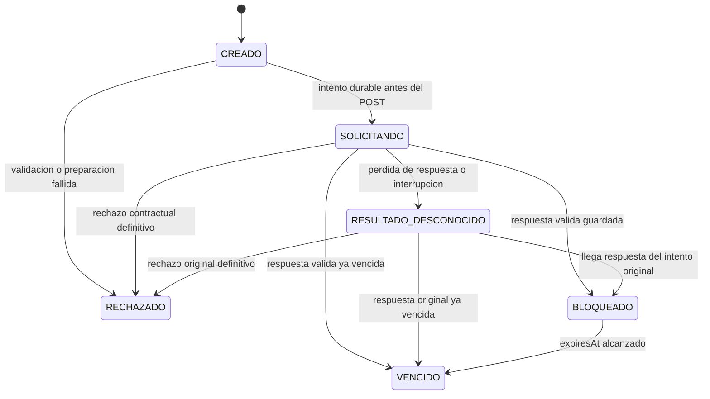

# Bloqueos temporales y procesos propios

## Alcance

Implementa la creación de un hold y la consulta de su proceso por el propietario. La [confirmación inicial REST](CONFIRMACION.md) amplía este flujo. El [intercambio de teléfono por Kafka](FLUJO_KAFKA.md) continúa el proceso después de la confirmación inicial. La cancelación de reservas sigue pendiente.

El bloqueo de cátedra es autoritativo: consultar disponibilidad antes no garantiza que el turno siga libre. El POST remoto decide el conflicto de manera definitiva. Turnos valida la agenda vigente mediante su API propia de catálogo antes de enviar el POST, sin consultar tablas ni replicar el catálogo.

## POST /api/turnos/bloqueos

Requiere JWT de usuario propio, cuenta persistida y activa. Un token de demostración sin `uid` no permite iniciar procesos. Cabecera obligatoria `Idempotency-Key`: UUID generado por el cliente una vez por intención de reserva y conservado para repetir esa misma petición.

Body:

```json
{"profesionalId":202,"fecha":"2026-11-10","horaInicio":"11:30"}
```

ID positivo, fecha entre hoy y hoy+90 días, hora futura en la zona configurada de atención y posición exacta de una regla habilitada. Acepta HH:mm y HH:mm:ss sin fracciones. Los campos de propietario/paciente enviados por el cliente se rechazan, igual que otros campos no admitidos. Las claves de idempotencia de distintos usuarios tienen ámbitos independientes.

El `externalPatientId` enviado a cátedra es el UUID público estable de la cuenta autenticada, no un identificador libre del body. Se propaga el JWT de usuario al catálogo y se utiliza exclusivamente el JWT técnico en el POST a cátedra.

Respuesta de creación 201 y `Location: /api/turnos/procesos/<id>`:

```json
{
  "id":"<uuid-local>",
  "profesionalId":202,
  "fecha":"2026-11-10",
  "horaInicio":"11:30:00",
  "estado":"BLOQUEADO",
  "holdId":"<hold-remoto>",
  "reservationProcessId":"<proceso-remoto>",
  "expiresAt":"2026-11-07T15:05:00Z",
  "ultimoError":null
}
```

Identificadores/instante ilustrativos; no hay una duración fija de hold definida por turnos. Se conserva exactamente el `expiresAt` recibido. Una respuesta remota que ya haya vencido se guarda VENCIDO. No se inventa ni extiende su TTL.

### Repetición y concurrencia

- Misma cuenta, misma clave y mismo slot: devuelve el proceso guardado sin consultar de nuevo las dependencias ni repetir el POST.
- Si ya quedó BLOQUEADO o VENCIDO, la repetición responde 200. Si sigue CREADO/SOLICITANDO o quedó RESULTADO_DESCONOCIDO, responde 202 y el Location del proceso.
- Misma clave usada para otro slot: 409 `IDEMPOTENCY_KEY_REUTILIZADA`.
- Otra clave para el mismo usuario/slot mientras haya un proceso activo: 409 `PROCESO_ACTIVO_EXISTENTE`, con referencia al proceso propio existente. Cambiar la clave no elude la protección de un resultado incierto.
- Solicitudes simultáneas se serializan solo durante la preparación local, mediante bloqueo de la fila del usuario y constraints de PostgreSQL. Nunca se mantiene esa transacción durante HTTP.
- Un rechazo definitivo se conserva y al repetir su clave se devuelve el mismo HTTP/código sin reenviar. Una nueva intención, por ejemplo después de corregir datos o restaurar catálogo tras un rechazo previo al envío, utiliza otra clave.
- Si un hold con vencimiento conocido ya expiró, se puede iniciar otra intención con una clave nueva; la cátedra vuelve a validar la disponibilidad.

## GET /api/turnos/procesos/{id}

JWT y cuenta activa obligatorios. Responde 200 con la misma vista del proceso propio, sea cual sea su estado. Un proceso inexistente o de otro usuario responde 404 `PROCESO_NO_ENCONTRADO`; no existe un parámetro para elegir otro propietario. La consulta no reenvía solicitudes a cátedra.

## Estados y persistencia



Migración `202611070001`: tabla `proceso_reserva` exclusiva de turnos, FK al usuario, UUID local, clave de idempotencia, profesional/fecha/hora seleccionados, estado, IDs remotos, vencimiento, error e instantes de auditoría. La referencia al profesional describe el slot del proceso y no constituye una réplica de catálogo. Horas como `time without time zone`; instantes como `timestamp with time zone`.

Constraints: clave única por usuario, IDs remotos únicos y como máximo un proceso activo del mismo usuario/slot. Se guarda CREADO antes de validar y SOLICITANDO antes del POST en operaciones locales durables.

Al consultar/repetir una operación:

- BLOQUEADO con TTL conocido cumplido pasa a VENCIDO.
- CREADO sin avance durante 30 segundos pasa a RECHAZADO (`VALIDACION_INTERRUMPIDA`), porque todavía no comenzó el envío; una compare-and-set impide que un hilo antiguo lo envíe después.
- SOLICITANDO sin avance durante 30 segundos pasa a RESULTADO_DESCONOCIDO. Ese umbral no es el TTL del hold.

Estas transiciones se realizan al consultar o iniciar operaciones del usuario; aún no hay un barrido periódico de procesos ni reconciliación general de reservas. Una respuesta tardía del intento original puede resolver un proceso desconocido; una repetición de la petición no genera otro intento remoto.

## Timeouts y límites del contrato externo

Conexión máxima 3 segundos y lectura 5 segundos por dependencia. El POST no tiene reintentos automáticos en la aplicación. Una desconexión, timeout, error 5xx, respuesta de éxito incompleta o estado HTTP no contractual produce resultado incierto: cátedra podría haber creado el hold.

La referencia recibida no define una clave remota de idempotencia ni un GET de recuperación/cancelación de holds. Por tanto **no se garantiza recuperar automáticamente un hold cuyo resultado se perdió**. No se inventa su expiración ni se libera el intento mediante una espera arbitraria. Permanece registrado y bloquea nuevas intenciones del mismo usuario/slot hasta poder esclarecerlo mediante un mecanismo autoritativo; la reconciliación de reservas se ampliará en el bloque de recuperación posterior.

Si cátedra responde correctamente pero falla PostgreSQL al guardar el resultado, permanece el intento SOLICITANDO ya persistido. La API devuelve 503 con `procesoId`; su consulta/repetición no vuelve a enviar. No existe una transacción distribuida capaz de deshacer el hold remoto al fallar la base local.

## Errores

Los errores propios usan `application/problem+json`, con `code` y, cuando ya existe un intento, `procesoId`. No se exponen cuerpos remotos, credenciales ni SQL.

| HTTP | Código | Situación |
| --- | --- | --- |
| 400 | VALIDATION_ERROR | Body, cabecera ausente o UUID mal formado |
| 400 | INVALID_SLOT | Fecha/hora inválida o posición fuera de agenda |
| 400 | PROFESSIONAL_DISABLED | Profesional o categoría deshabilitados |
| 404 | PROFESIONAL_NO_ENCONTRADO / PROFESSIONAL_NOT_FOUND | Referencia inexistente en catálogo / rechazo contractual de cátedra |
| 404 | PROCESO_NO_ENCONTRADO | No existe proceso propio con ese ID |
| 409 | IDEMPOTENCY_KEY_REUTILIZADA | Misma clave para otra intención |
| 409 | PROCESO_ACTIVO_EXISTENTE | Ya hay un intento propio activo para el slot |
| 409 | SLOT_ALREADY_HELD / SLOT_ALREADY_RESERVED | Conflicto contractual remoto |
| 503 | INTEGRACION_NO_CONFIGURADA / INTEGRACION_NO_AUTORIZADA | Configuración técnica ausente o rechazada |
| 503 | DEPENDENCIA_NO_DISPONIBLE | No se pudo validar catálogo antes de enviar |
| 503 | VALIDACION_INTERRUMPIDA | Preparación local interrumpida antes del envío |
| 503 | RESULTADO_HOLD_DESCONOCIDO | No se puede asegurar el resultado del POST |
| 503 | PERSISTENCIA_NO_DISPONIBLE | Fallo local de base de datos |

Una respuesta de catálogo inválida conserva su 502. Cátedra puede devolver 400 VALIDATION_ERROR, que se conserva como rechazo definitivo. Los 401/403 de usuario siguen el contrato de seguridad existente. Un 401/403 remoto se traduce en error de integración, no en cierre de sesión del usuario.

## Pruebas

`./mvnw test` y `./mvnw package` incluyen `BloqueosHttpTest`, con PostgreSQL Testcontainers y servidores HTTP locales. Cubren propiedad, autenticación, contrato/credenciales, agenda, conflictos, idempotencia, concurrencia, vencimiento, respuesta perdida, timeout real de lectura, interrupción durable y fallo de persistencia posterior al hold. No crean holds contra cátedra ni cambian sus ocupaciones.

## Ampliación: confirmación inicial

El estado incorpora CONFIRMANDO, ESPERANDO_TELEFONO, CONFIRMACION_DESCONOCIDA y CONFIRMACION_RECHAZADA. La vista agrega `confirmacionExpiresAt`, nulo antes de aceptar la confirmación. La espera o incertidumbre de confirmación no se transforma automáticamente en VENCIDO usando el TTL del hold. El diagrama anterior describe solo la creación del hold; ver [confirmación REST](CONFIRMACION.md) para las transiciones posteriores.
